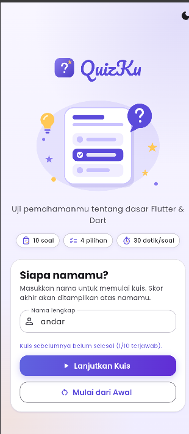
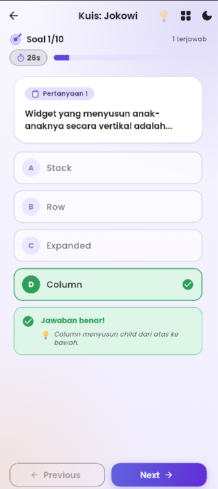
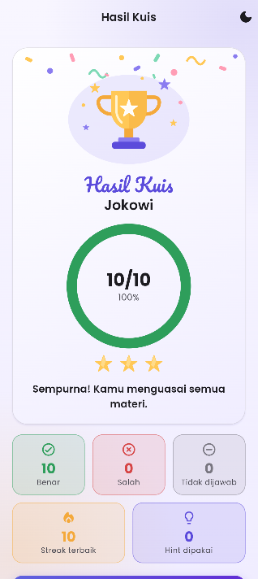

# QuizKu

**Aplikasi kuis pilihan ganda berbasis Flutter**

---

## Daftar Isi

1. [Identitas Mahasiswa](#1-identitas-mahasiswa)
2. [Informasi Aplikasi](#2-informasi-aplikasi)
3. [Dokumentasi](#3-dokumentasi)
4. [Alur Aplikasi](#4-alur-aplikasi)
5. [Implementasi Kriteria Tugas](#5-implementasi-kriteria-tugas)
6. [Arsitektur dan State Management](#6-arsitektur-dan-state-management)
7. [Responsive dan Adaptive Design](#7-responsive-dan-adaptive-design)
8. [Struktur Proyek](#8-struktur-proyek)
9. [Cara Menjalankan](#9-cara-menjalankan)
10. [Pengujian](#10-pengujian)
11. [Presentasi](#11-presentasi)

---

## 1. Identitas Mahasiswa

| | |
|---|---|
| **Nama** | Andareas Pegri Damanik |
| **NIM** | 241401116 |
| **Lab** | Pemrograman Mobile 4 |

---

## 2. Informasi Aplikasi

| | |
|---|---|
| **Nama Aplikasi** | QuizKu |
| **Tema** | Aplikasi Kuis Pilihan Ganda |

### Deskripsi Singkat

QuizKu adalah aplikasi kuis pilihan ganda berbasis Flutter yang dirancang untuk menguji pemahaman dasar tentang Flutter dan Dart. Pengguna memulai dengan memasukkan nama, kemudian menjawab 10 soal pilihan ganda dengan batas waktu 30 detik per soal. Setiap soal dilengkapi umpan balik langsung beserta penjelasan jawaban, sehingga kuis ini juga berfungsi sebagai sarana belajar. Di akhir kuis, pengguna melihat skor, persentase, peringkat bintang, dan ringkasan jawaban untuk setiap soal.

Untuk membuat kuis lebih menarik, QuizKu dilengkapi sistem hint yang diperoleh dari jawaban benar, penghitung streak jawaban beruntun, serta grid nomor soal untuk berpindah antar-soal dengan cepat. Urutan soal dan pilihan jawaban diacak pada setiap putaran agar kuis tidak monoton.

Aplikasi ini menggunakan Provider untuk state management sehingga progres jawaban tetap tersimpan saat layar dirotasi maupun saat berpindah halaman. Tampilannya mendukung mode terang dan gelap, serta menyesuaikan diri dengan ukuran layar ponsel, tablet, dan web. Seluruh data soal bersifat lokal sehingga aplikasi tidak memerlukan database maupun koneksi internet.

### Fitur yang Tersedia

**Fitur utama**

| Fitur | Keterangan |
|---|---|
| Input nama dan validasi | Tidak boleh kosong atau hanya spasi, minimal 2 karakter, maksimal 30 karakter |
| 10 soal pilihan ganda | 4 pilihan per soal, 1 jawaban benar, jawaban terkunci setelah dipilih |
| Indikator progres | "Soal x/10", progress bar animasi, dan jumlah soal terjawab |
| Feedback langsung | Hijau (benar), merah (salah), jawaban benar ditandai, disertai penjelasan singkat |
| Navigasi soal | Tombol Previous dan Next, jawaban tetap tersimpan saat pindah soal |
| Konfirmasi submit | Dialog yang menyebut jumlah soal yang belum dijawab |
| Halaman hasil | Skor, persentase, bintang, pesan sesuai skor, statistik benar/salah/kosong, ringkasan tiap soal |
| Ulangi dan kembali | Tombol Ulangi Kuis dan Kembali ke Beranda |
| Lanjutkan kuis | Beranda menawarkan Lanjutkan Kuis atau Mulai dari Awal jika ada progres |

**Fitur tambahan**

| Fitur | Cara kerja |
|---|---|
| Reward hint | Setiap 5 jawaban benar mendapat 1 hint. Ikon bohlam di AppBar menampilkan jumlah hint. Memakainya mencoret 2 pilihan salah pada soal yang sedang tampil (satu hint per soal, hanya sebelum menjawab). |
| Streak / combo | Menghitung jawaban benar beruntun. Lencana `x2`, `x3`, dan seterusnya muncul di header kuis. Streak terbaik tampil di halaman hasil. Jawaban salah atau waktu habis memutus streak. |
| Timer 30 detik per soal | Hitung mundur di header, berwarna merah saat 10 detik terakhir. Waktu habis mengunci soal dan dihitung salah. Sisa waktu tiap soal tersimpan saat pindah soal, dan timer berhenti sementara saat dialog atau grid terbuka. |
| Acak soal dan pilihan | Urutan soal dan pilihan diacak setiap kuis dimulai atau diulang. Urutan stabil selama kuis berlangsung (aman saat rotasi). |
| Grid nomor soal | Ikon grid di AppBar membuka bottom sheet nomor 1 sampai 10 dengan warna status. Ketuk nomor untuk lompat ke soal. |
| Haptic feedback | Getar ringan untuk jawaban benar, getar kuat untuk salah atau waktu habis, getar sedang saat hint didapat atau dipakai. |
| Animasi dan ilustrasi | Transisi halaman (fade dan slide), transisi antar-soal, angka skor naik, ilustrasi hasil sesuai skor, konfeti untuk skor tinggi. |
| Pintasan keyboard | Di web/desktop: `←` `→` pindah soal, `A` sampai `D` atau `1` sampai `4` memilih jawaban, `H` memakai hint, `G` membuka grid soal. |

**Bonus**

- Dual theme (Light dan Dark) dengan tombol toggle di setiap halaman.
- Adaptive dan responsive design untuk ponsel, tablet, dan web (lihat [bagian 7](#7-responsive-dan-adaptive-design)).

---

## 3. Dokumentasi

### 3.1 Credit Sumber Aset

**Gambar dan ikon**

Aset visual berformat SVG (palet ungu `#5B4BDB` dengan aksen amber):

- `assets/icons/`: `logo`, `star`, `lightbulb`, `target`, `clipboard`, `timer`
- `assets/illustrations/`: `hero_quiz`, `result_champion`, `result_good`, `result_keep_going`, `confetti`
- Ikon fungsional (tombol dan indikator benar/salah) memakai [Material Icons](https://fonts.google.com/icons) bawaan Flutter (Apache 2.0).

**Font**

- [Poppins](https://fonts.google.com/specimen/Poppins), hak cipta The Poppins Project Authors, lisensi [SIL OFL 1.1](assets/fonts/OFL.txt)
- [Pacifico](https://fonts.google.com/specimen/Pacifico), hak cipta The Pacifico Project Authors, lisensi [SIL OFL 1.1](assets/fonts/OFL-Pacifico.txt)

**Package**

- [Flutter](https://flutter.dev)
- [provider](https://pub.dev/packages/provider)
- [flutter_svg](https://pub.dev/packages/flutter_svg)

### 3.2 Screenshot Tiap Halaman

| Halaman | Light                                       | 
|---|---------------------------------------------|
| **Beranda** (input nama) |  | 
| **Kuis** |     |
| **Hasil** |   |

### 3.3 Link Mockup / Prototype

**https://www.figma.com/design/BeomZdg4bOLQJ47ktodmeR/Mockup-Quizku?node-id=0-1&t=pbghW8EIKO4n4dIX-1**

---

## 4. Alur Aplikasi

```
┌──────────────┐  nama valid   ┌──────────────┐  Selesai +    ┌──────────────┐
│  HomeScreen  │ ────────────▶ │  QuizScreen  │  konfirmasi   │ ResultScreen │
│  input nama  │               │ soal 1 … 10  │ ────────────▶ │ skor+ringkas │
└──────────────┘ ◀──────────── └──────────────┘               └──────────────┘
        ▲            back                                            │
        └──────── Kembali ke Beranda / Ulangi Kuis ◀─────────────────┘
```

| Perpindahan | Kode | Jenis |
|---|---|---|
| Beranda ke Kuis | `home_screen.dart` | `Navigator.push` |
| Kuis ke Hasil | `quiz_screen.dart` | `Navigator.pushReplacement` |
| Hasil ke Kuis (Ulangi) | `result_screen.dart` | `Navigator.pushReplacement` |
| Hasil ke Beranda | `result_screen.dart` | `Navigator.pop` |

Semua perpindahan memakai animasi `fadeSlideRoute` dari `utils/page_transitions.dart`.

---

## 5. Implementasi Kriteria Tugas

### Kriteria wajib

| # | Kriteria | Lokasi / Implementasi |
|---|---|---|
| 1 | `StatelessWidget` dan `StatefulWidget` | Stateful: `HomeScreen`, `QuizScreen`, `ResultScreen` (butuh controller, `Timer`, dan snapshot). Stateless: seluruh widget di `lib/widgets/` |
| 2 | Minimal 2 halaman dan navigasi | 3 halaman di `lib/screens/`, dihubungkan dengan `Navigator` |
| 3 | Widget reusable di file terpisah | 26 file di `lib/widgets/`, misalnya `CustomButton`, `AnswerOption`, `QuestionCard`, `ProgressHeader`, `ScoreCard`, `TimerChip`, `StreakBadge`, `HintButton`, `QuestionGrid` |
| 4 | Aset gambar / ikon | 11 SVG di `assets/icons/` dan `assets/illustrations/`, dipakai lewat `flutter_svg`, path dipusatkan di `utils/app_assets.dart` |
| 5 | Font kustom | Poppins (teks isi) dan Pacifico (judul brand) di `assets/fonts/`, didaftarkan di `pubspec.yaml` dan dipasang di `theme/app_theme.dart` |
| 6 | Ukuran UI dinamis | `utils/responsive.dart`, `MediaQuery`, `LayoutBuilder`, `Expanded`, `AppSpacing`, ukuran ilustrasi berbasis lebar layar |
| 7 | State management | `QuizProvider` dan `ThemeProvider` di atas `MaterialApp` (`main.dart`) |
| 8 | Tanpa database | Soal lokal di `data/dummy_questions.dart` |
| 9 | GitHub sebagai pelacak kemajuan | Lihat riwayat di tab **Commits** repository ini |
| 10 | Desain bebas | Tema Material 3, gradien, ilustrasi per skor, animasi, serta fitur tambahan pada bagian 2 |

### Bonus

| Bonus | Implementasi |
|---|---|
| Dual theme | `ThemeProvider`, `AppTheme.light` dan `AppTheme.dark`, serta `ThemeExtension` untuk warna benar/salah |
| Adaptive dan responsive | Layout 1 atau 2 kolom, batas lebar konten, skala teks adaptif |

---

## 6. Arsitektur dan State Management

```
 MultiProvider (di atas MaterialApp)
   ├── ThemeProvider  →  ThemeMode (light / dark)
   └── QuizProvider   →  nama · indeks soal · jawaban · sisa waktu
                         streak · hint · urutan soal acak
            ▲
            │  context.watch / read / select
   HomeScreen · QuizScreen · ResultScreen
```

- **Provider di atas `MaterialApp`:** saat layar dirotasi, widget dibangun ulang tetapi provider tetap hidup, sehingga progres tidak hilang.
- **Skor dihitung dari daftar jawaban**, bukan disimpan sebagai variabel terpisah, sehingga selalu sinkron.
- **Hint diturunkan dari skor:** `skor ~/ 5` dikurangi hint yang sudah dipakai.
- **`ResultScreen` mengambil snapshot** data sekali di `initState` agar tampilan tidak berkedip saat kuis di-reset.
- **`StatefulWidget` hanya untuk state lokal** (controller form, arah animasi, `Timer` yang di-cancel saat halaman ditutup). Data yang harus bertahan berada di provider.
- **Sumber data:** `dummyQuestions` (`data/dummy_questions.dart`) menjadi nilai bawaan `QuizProvider`, lalu diacak oleh `Question.shuffled()` dan `restartQuiz()`.

---

## 7. Responsive dan Adaptive Design

Aturan dipusatkan di `lib/utils/responsive.dart`.

| Kondisi layar | Perilaku |
|---|---|
| Ponsel dan tablet portrait | 1 kolom, lebar konten maksimum 640 |
| Landscape dan web lebar (lebar ≥ 720) | 2 kolom (soal di kiri, opsi di kanan), lebar maksimum 1000 |
| Lebar ≥ 840 / ≥ 1200 | Teks diperbesar 1,1× / 1,2× lewat `AdaptiveTextScale` |
| Semua layar | Padding horizontal 5% lebar, dibatasi 16 sampai 32 |

---

## 8. Struktur Proyek

```
lib/
├── main.dart                    # entry point, MultiProvider + MaterialApp
├── models/question.dart         # model soal (immutable)
├── data/dummy_questions.dart    # 10 soal lokal
├── providers/
│   ├── quiz_provider.dart       # state kuis
│   └── theme_provider.dart      # ThemeMode light/dark
├── screens/
│   ├── home_screen.dart         # Halaman 1: input nama
│   ├── quiz_screen.dart         # Halaman 2: kuis
│   └── result_screen.dart       # Halaman 3: hasil
├── widgets/                     # 26 komponen UI reusable
├── theme/                       # app_theme, app_gradients, app_spacing
└── utils/                       # app_assets, responsive, page_transitions,
                                 # score_feedback, haptics
assets/
├── fonts/                       # Poppins, Pacifico (+ lisensi OFL)
├── icons/                       # ikon SVG
└── illustrations/               # ilustrasi SVG
test/                            # unit test dan widget test
docs/screenshots/                # screenshot untuk README
```

---

## 9. Cara Menjalankan

**Prasyarat:** Flutter SDK (Dart ^3.13). Cek dengan `flutter doctor`.

```bash
git clone <https://github.com/Andar24/QuizApp_PM4.git>
cd quizapp
flutter pub get
flutter run                # pilih emulator / perangkat
flutter run -d chrome      # versi web
```

> Jika `flutter run -d chrome` gagal, pastikan path folder proyek tidak mengandung karakter `#`.

---

## 10. Pengujian

```bash
flutter analyze
flutter test
```

Folder `test/` berisi 98 deklarasi test (sebagian dijalankan dalam perulangan, misalnya untuk beberapa ukuran layar):

| Berkas | Yang diuji |
|---|---|
| `quiz_provider_test.dart` | Logika jawaban, skor, navigasi soal, reset |
| `features_test.dart` | Hint, streak, timer, acak soal, grid nomor soal, statistik hasil |
| `home_screen_test.dart` | Validasi nama, lanjutkan / mulai dari awal |
| `quiz_screen_test.dart` | Pilih jawaban, feedback, Previous/Next, submit |
| `result_screen_test.dart` | Skor, ringkasan, ulangi kuis, kembali ke beranda |
| `responsive_test.dart` | Breakpoint 1/2 kolom dan skala teks |
| `assets_and_theme_test.dart` | Keberadaan aset dan tema light/dark |
| `widgets_test.dart`, `widget_test.dart` | Komponen reusable dan smoke test aplikasi |

---

<div align="center">Dibuat untuk tugas UTS Pemrograman Mobile</div>